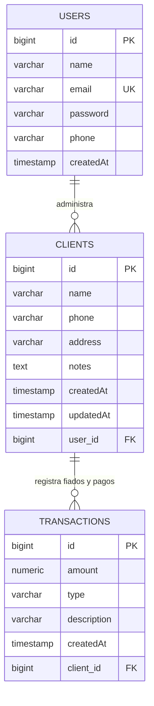

# Documentación de Base de Datos y Pool de Conexiones (HikariCP)
## Proyecto Slate – Ingeniería de Software Aplicada (Universidad de Mendoza)

---

## 1. Motor de Base de Datos y Versiones

- **Desarrollo Local:** PostgreSQL 18.3 x64 ejecutándose en el host (Windows 10, puerto 5432).
- **Entorno de Contenedores (Docker Compose - Fase 5):** PostgreSQL 16 Alpine.
- **Entorno en la Nube (Azure - Fase 7):** Azure Database for PostgreSQL – Flexible Server (PostgreSQL 16), tier `Standard_B1ms` (1 vCPU, 2 GiB RAM, 32 GiB Storage).

---

## 2. Modelo de Datos y Entidades JPA

La persistencia está implementada mediante **Spring Data JPA** y **Hibernate ORM**.

### Estrategia de Generación de Claves Primarias:
- Se utiliza `@GeneratedValue(strategy = GenerationType.IDENTITY)` en todas las entidades (`User`, `Client`, `Transaction`).
- En PostgreSQL, esta estrategia se traduce en columnas nativas `BIGSERIAL` o `GENERATED BY DEFAULT AS IDENTITY`.
- **Justificación técnica:** Evita las tablas de secuencias centralizadas o bloqueos de transacciones que generan estrategias como `TABLE` o `AUTO`, permitiendo que el motor de PostgreSQL asigne el ID atómicamente en la inserción.

### Multi-tenancy por Usuario:
- Cada consulta en `ClientRepository` y `TransactionRepository` filtra estrictamente por el `user_id` del comerciante autenticado, garantizando el aislamiento de datos entre usuarios.

---

## 3. HikariCP: Dimensionamiento y Justificación

**HikariCP** es el connection pool de alto rendimiento predeterminado en Spring Boot.

### Parámetros Configurados (`application.yaml`):

| Parámetro | Valor Local (`dev`) | Valor Azure (`prod`) | Justificación Técnica |
| :--- | :---: | :---: | :--- |
| `maximum-pool-size` | 10 | **5** | En Azure, el tier `Standard_B1ms` admite un máximo de **50 conexiones concurrentes** para toda la instancia. Al limitar el pool a 5 por réplica de Container Apps, se previene agotar los slots de conexión (`FATAL: remaining connection slots are reserved...`) durante reinicios o escalado. |
| `minimum-idle` | 2 | **2** | Mantiene 2 conexiones calientes listas para responder solicitudes instantáneamente sin penalidad de handshake TCP/TLS. |
| `connection-timeout` | 20000 ms (20s) | 20000 ms (20s) | Tiempo máximo que un hilo esperará por una conexión libre antes de lanzar `SQLTransientConnectionException`. |
| `idle-timeout` | 30000 ms (30s) | 30000 ms (30s) | Tiempo tras el cual una conexión ociosa por encima de `minimum-idle` es cerrada y reciclada. |
| `max-lifetime` | 1800000 ms (30m) | 1800000 ms (30m) | Tiempo de vida total de una conexión. Debe ser inferior a cualquier timeout de firewall TCP de Azure (típicamente 4 a 30 min) para evitar excepciones por sockets cerrados silenciosamente por la red. |
| `pool-name` | `SlateHikariPool` | `SlateHikariPool` | Facilita la identificación en logs, JMX y métricas de Actuator. |

---

## 4. Diferencias Clave: Entorno Local vs. Azure Flexible Server

| Aspecto | Entorno Local (`dev`) | Azure Database for PostgreSQL (`prod`) |
| :--- | :--- | :--- |
| **Cadena JDBC** | `jdbc:postgresql://localhost:5432/slate_db` | `jdbc:postgresql://<servidor>.postgres.database.azure.com:5432/slate_db?sslmode=require` |
| **Cifrado SSL/TLS** | Opcional / Desactivado | **Obligatorio (`sslmode=require`)**. Azure rechaza conexiones sin TLS 1.2+. |
| **Estrategia DDL** | `ddl-auto: update` (crea/actualiza tablas) | `ddl-auto: validate` (no altera el esquema automáticamente, previene pérdidas de datos accidentales). |
| **Red y Firewall** | Acceso directo `127.0.0.1` | Requiere habilitar regla de firewall: *"Allow public access from any Azure service"* o IP específica del desarrollador. |
| **Control de Costos** | Gratis (host local) | ~\$0.017/hora en cómputo. **Debe detenerse cuando no se use**. |

---

## 5. Buenas Prácticas de Seguridad Implementadas

1. **Aislamiento Total de Secretos:** Ninguna credencial de base de datos se encuentra hardcodeada en el código fuente. Se inyectan mediante variables de entorno:
   - `DB_URL`
   - `DB_USER`
   - `DB_PASSWORD`
2. **Archivos de Entorno Ignorados:** `.env` está expresamente excluido en [.gitignore](file:///C:/Users/alexp/Documents/GitHub/slate-back-isa/.gitignore) y [.dockerignore](file:///C:/Users/alexp/Documents/GitHub/slate-back-isa/.dockerignore).
3. **Plantilla Segura:** Se provee [.env.example](file:///C:/Users/alexp/Documents/GitHub/slate-back-isa/.env.example) con valores de muestra para desarrollo sin credenciales reales.

